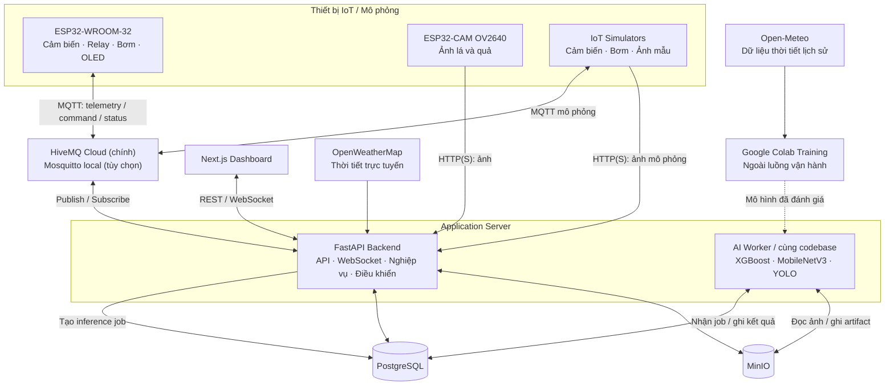
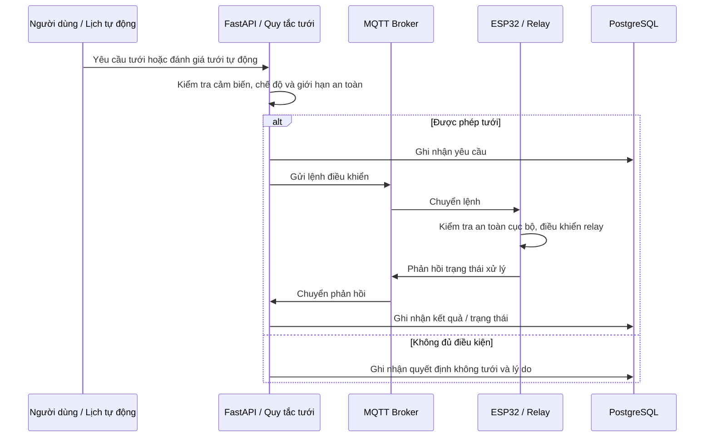

# System Architecture — AIoT Plant Care

## 1. Tổng quan hệ thống

AIoT Plant Care là hệ thống giám sát và hỗ trợ chăm sóc **cây cà chua**, mô hình trồng trong chậu thử nghiệm bằng phần cứng thực tế. Hệ thống kết hợp dữ liệu môi trường, điều khiển tưới và phân tích hình ảnh lá/quả nhằm cung cấp thông tin hữu ích cho quá trình chăm sóc cây.

Các năng lực chính:

- **Giám sát môi trường:** Nhiệt độ, độ ẩm không khí, độ ẩm đất và áp suất khí quyển.
- **Tưới nước thông minh:** Theo dõi độ ẩm đất, điều khiển bật/tắt bơm theo chế độ thủ công hoặc tự động, có giới hạn an toàn.
- **Dự báo mưa:** Ước lượng khả năng mưa trong **60 phút tiếp theo** để hỗ trợ quyết định tưới.
- **Phân tích lá cà chua:** Phân loại lá khỏe và các bệnh nằm trong phạm vi dữ liệu huấn luyện.
- **Phân tích quả cà chua:** Phát hiện vị trí, đếm và phân loại độ chín của quả trong ảnh; nhận diện bệnh/bất thường trên quả là hướng mở rộng.
- **Giám sát qua Web:** Xem trạng thái thiết bị, dữ liệu theo thời gian thực, lịch sử tưới, hình ảnh và kết quả AI.
- **Mô phỏng:** Chạy và kiểm thử phần mềm khi chưa kết nối phần cứng thực tế.

**Nguyên tắc cốt lõi:** AI cung cấp kết quả dự đoán và thông tin hỗ trợ; **quyết định kích hoạt bơm phải đi qua cơ chế điều khiển có kiểm tra an toàn**, không để mô hình AI trực tiếp điều khiển phần cứng.

## 2. Sơ đồ kiến trúc tổng quan

Sơ đồ thể hiện **quan hệ logic**, Backend theo hướng **Modular Monolith**: triển khai thống nhất nhưng phân tách rõ nghiệp vụ và tích hợp bên ngoài.

## 3. Các thành phần và ranh giới trách nhiệm

### 3.1. IoT Devices — Thiết bị tại cây trồng

**ESP32-WROOM-32** là bộ điều khiển tại chỗ:

- Đọc dữ liệu từ **DHT22**, **BMP180** và **cảm biến độ ẩm đất**.
- Gửi dữ liệu đo và trạng thái thiết bị đến hệ thống qua Wi-Fi/MQTT.
- Nhận yêu cầu bật/tắt bơm, điều khiển **relay** và phản hồi kết quả xử lý lệnh.
- Hiển thị thông tin phù hợp trên **OLED I2C**.
- Duy trì các cơ chế bảo vệ cơ bản ngay trên thiết bị, kể cả khi mất kết nối Backend.

**ESP32-CAM OV2640** đảm nhiệm thu nhận hình ảnh lá/quả và truyền ảnh về Backend qua HTTP/HTTPS. Thiết bị này **không chạy** XGBoost, MobileNetV3 hay YOLO; các mô hình được suy luận ở phía máy chủ.

Việc đọc cảm biến, chụp ảnh và điều khiển bơm được xem là các khả năng riêng biệt; sự cố camera không được làm vô hiệu hóa các giới hạn an toàn của bơm.

### 3.2. Communication — Giao tiếp

| Kênh                    | Vai trò                                                                                 |
| ----------------------- | --------------------------------------------------------------------------------------- |
| **MQTT / HiveMQ Cloud** | Truyền dữ liệu cảm biến, lệnh điều khiển và phản hồi trạng thái giữa ESP32 với Backend. |
| **HTTP/HTTPS**          | Gửi ảnh từ ESP32-CAM, trao đổi dữ liệu với API và các nhà cung cấp thời tiết.           |
| **REST API**            | Giao tiếp nghiệp vụ giữa Next.js và FastAPI.                                            |
| **WebSocket**           | Đẩy cập nhật trạng thái và dữ liệu mới đến Dashboard mà không phải tải lại trang.       |

MQTT phù hợp với bản tin trạng thái và điều khiển dung lượng nhỏ; ảnh từ camera được truyền bằng HTTP/HTTPS thay vì đẩy nguyên ảnh qua luồng MQTT điều khiển.

Các thông điệp qua ranh giới thiết bị và Backend cần diễn đạt nhất quán **nguồn dữ liệu, định danh thiết bị, thời điểm ghi nhận, đơn vị đo, trạng thái và phiên bản giao thức**.

### 3.3. Backend — FastAPI

Backend giữ vai trò trung tâm kết nối Dashboard, thiết bị IoT, các mô hình AI và hệ thống lưu trữ. Về mặt kiến trúc, những nhóm trách nhiệm chính gồm:

| Nhóm trách nhiệm            | Phạm vi                                                                              |
| --------------------------- | ------------------------------------------------------------------------------------ |
| **Ứng dụng & truy cập**     | Cung cấp dữ liệu cho Dashboard và kiểm soát thao tác người dùng.                     |
| **Quản lý cây và thiết bị** | Quản lý đối tượng được theo dõi, khả năng thiết bị, cấu hình và trạng thái kết nối.  |
| **Dữ liệu cảm biến**        | Tiếp nhận, kiểm tra, chuẩn hóa, lưu và phân phối dữ liệu môi trường.                 |
| **Điều khiển tưới**         | Quản lý chế độ tưới, quy tắc ra quyết định, yêu cầu điều khiển và lịch sử hoạt động. |
| **Hình ảnh & phân tích AI** | Tiếp nhận ảnh, kết nối mô hình suy luận, lưu kết quả và liên kết với ảnh gốc.        |
| **Tích hợp bên ngoài**      | Giao tiếp MQTT Broker, dịch vụ thời tiết và các thành phần lưu trữ.                  |
| **Theo dõi hệ thống**       | Ghi nhận lỗi, tình trạng xử lý và thông tin phục vụ kiểm tra, truy vết.              |

### 3.4. Frontend — Next.js

Next.js là giao diện quan sát và tương tác.

Các góc nhìn chính bao gồm: tổng quan tình trạng cây, dữ liệu cảm biến và biểu đồ lịch sử, trạng thái kết nối thiết bị, chế độ tưới, lịch sử điều khiển, ảnh lá/quả cùng kết quả phân tích AI. Giao diện cần phân biệt dữ liệu **đang cập nhật**, **đã cũ**, **mô phỏng** và **không khả dụng**; không tự suy diễn trạng thái bơm chỉ từ thao tác nhấn nút.

### 3.5. Data Storage — PostgreSQL và MinIO

- **PostgreSQL:** Lưu thông tin có cấu trúc và quan hệ như cây được theo dõi, thiết bị, bản ghi cảm biến, cấu hình tưới, sự kiện điều khiển, dữ liệu thời tiết và metadata kết quả AI.
- **MinIO:** Lưu ảnh gốc từ camera, ảnh mẫu phục vụ mô phỏng, ảnh/kết quả minh họa và các tệp nhị phân thích hợp.
- **Liên kết dữ liệu:** Các bản ghi trong PostgreSQL tham chiếu đến đối tượng ảnh trong MinIO để có thể truy xuất ảnh gốc cùng kết quả suy luận.

Dữ liệu có nguồn gốc khác nhau (thiết bị thật, mô phỏng, API thời tiết, dataset) cần được ghi nhận nguồn rõ ràng. Lịch sử hoạt động nên lưu được **thời điểm xảy ra sự kiện** và **thời điểm hệ thống tiếp nhận** khi hai thời điểm khác nhau.

### 3.6. AI / Machine Learning

Các mô hình được huấn luyện, đánh giá và quản lý độc lập với luồng nhận dữ liệu thiết bị. Hệ thống vận hành sử dụng **phiên bản mô hình đã được đánh giá** để suy luận.

| Năng lực AI              | Bài toán                                         | Đầu vào khái quát                                                    | Đầu ra khái quát                                             |
| ------------------------ | ------------------------------------------------ | -------------------------------------------------------------------- | ------------------------------------------------------------ |
| **Dự báo mưa 60 phút**   | Binary Classification — XGBoost                  | Dữ liệu thời tiết và đặc trưng lịch sử có sẵn tại thời điểm dự đoán. | Xác suất/nhãn có mưa trong 60 phút tới.                      |
| **Bệnh lá cà chua**      | Multi-class Image Classification — MobileNetV3   | Ảnh lá phù hợp với phạm vi dữ liệu đã huấn luyện.                    | Nhãn bệnh/lá khỏe và độ tin cậy.                             |
| **Theo dõi quả cà chua** | Object Detection — YOLO                          | Ảnh chứa một hoặc nhiều quả.                                         | Vị trí, số lượng và nhãn độ chín của các quả được phát hiện. |
| **Bất thường trên quả**  | Image Classification hoặc phương pháp CV phù hợp | Ảnh quả và bộ dữ liệu bệnh/bất thường có nhãn.                       | Kết quả nhận diện trong phạm vi mô hình được huấn luyện.     |

**Nguồn dữ liệu thời tiết:** Open-Meteo Historical Weather API được định hướng cho dữ liệu lịch sử phục vụ huấn luyện; OpenWeatherMap API phục vụ thông tin thời tiết trực tuyến. Dữ liệu cảm biến tại chỗ có thể hỗ trợ đánh giá hoặc cải thiện dự báo khi đã tích lũy đủ lịch sử phù hợp.

**Nguyên tắc đánh giá:** Dự báo mưa cần tách dữ liệu theo thời gian và tránh sử dụng thông tin tương lai làm đặc trưng đầu vào. Mô hình ảnh cần được kiểm tra trên ảnh thực tế từ ESP32-CAM, không chỉ trên ảnh dataset. Nhãn AI là kết quả dự đoán, không mặc nhiên là chẩn đoán chắc chắn; ngoài phạm vi dữ liệu huấn luyện cần thể hiện mức độ không chắc chắn.

## 4. Các luồng hoạt động chính

### 4.1. Thu thập và hiển thị dữ liệu cảm biến

1. ESP32 đọc cảm biến và gửi bản tin đo qua MQTT.
2. Backend tiếp nhận, kiểm tra tính hợp lệ, chuẩn hóa đơn vị và ghi nhận thời điểm/nguồn dữ liệu.
3. Dữ liệu được lưu vào PostgreSQL để phục vụ biểu đồ và lịch sử.
4. Dashboard nhận cập nhật qua WebSocket; khi cần có thể lấy dữ liệu lịch sử qua REST API.

Dữ liệu cảm biến không hợp lệ, quá cũ hoặc mất kết nối phải được thể hiện đúng trạng thái, thay vì giữ giá trị cũ như thể vừa được đo.

### 4.2. Quyết định và thực hiện tưới nước

Cơ chế tự động lấy **độ ẩm đất** làm tín hiệu quan trọng, có thể tham khảo dự báo mưa và điều kiện môi trường, nhưng không phụ thuộc tuyệt đối vào độ chính xác của AI. Tưới thủ công cũng phải tuân theo giới hạn an toàn.

Các nguyên tắc vận hành:

- **Fail-safe:** Khi thiếu dữ liệu quan trọng, dữ liệu quá cũ hoặc kết nối điều khiển không tin cậy, hệ thống không tự ý bắt đầu một chu kỳ tưới mới.
- **Giới hạn tại thiết bị:** Firmware phải có thời gian bật bơm tối đa và hành vi an toàn khi khởi động lại/mất liên lạc, không chỉ trông chờ vào Backend.
- **Ngăn tưới lặp:** Tránh xử lý trùng lệnh và bật/tắt liên tục; có thể dùng khoảng nghỉ giữa các chu kỳ tưới.
- **Trạng thái minh bạch:** Phân biệt _đã yêu cầu_, _đã được thiết bị xác nhận_ và _đã thực sự đo được_. Với phần cứng hiện có, phản hồi relay không chứng minh được lưu lượng nước thực tế.
- **Kiểm soát lượng nước:** Relay chỉ thực hiện bật/tắt. Lượng nước có thể **ước tính** từ lưu lượng bơm đã hiệu chuẩn và thời gian chạy; để đo trực tiếp cần thêm cảm biến lưu lượng hoặc phương pháp đo khác.
- **Quy tắc ưu tiên:** Bảo vệ thiết bị/cây trồng và thao tác dừng khẩn cấp luôn được ưu tiên so với dự báo AI hoặc lịch tưới.

### 4.3. Thu nhận và phân tích hình ảnh

1. ESP32-CAM hoặc Camera Simulator cung cấp ảnh lá/quả cho Backend qua HTTP/HTTPS.
2. Backend kiểm tra nguồn ảnh, định dạng và kích thước trước khi lưu ảnh vào MinIO.
3. Ảnh được phân tích bằng mô hình phù hợp với **mục đích**: phân loại bệnh lá hoặc phát hiện/đếm/phân loại độ chín của quả.
4. Kết quả suy luận được liên kết với ảnh gốc, thời điểm phân tích và phiên bản mô hình, sau đó cung cấp cho Dashboard.

Một ảnh có nhiều quả phù hợp với Object Detection; ảnh một chiếc lá được chụp tương đối rõ phù hợp với Image Classification. Phát hiện quả không đồng nghĩa với nhận diện bệnh trên quả; đây là hai năng lực khác nhau.

### 4.4. Thời tiết và dự báo mưa

1. Hệ thống lấy thông tin thời tiết từ dịch vụ bên ngoài, kèm thời điểm và nguồn dữ liệu.
2. Các đặc trưng thích hợp được cung cấp cho mô hình XGBoost để ước lượng khả năng mưa trong 60 phút tiếp theo.
3. Kết quả dự báo được hiển thị và dùng làm **tín hiệu hỗ trợ** cho chính sách tưới.
4. Nếu dịch vụ thời tiết hoặc mô hình không khả dụng, cơ chế tưới cần có hành vi dự phòng dựa trên dữ liệu tại chỗ và các giới hạn an toàn.

Không trộn lẫn **quan trắc thực tế**, **dự báo từ API** và **dự báo do mô hình của dự án tạo ra** mà không ghi rõ nguồn.

## 5. Chế độ hoạt động và mô phỏng

Kiến trúc tách **nghiệp vụ** khỏi **nguồn dữ liệu/thiết bị**. Hệ thống có thể hoạt động với các nguồn tương đương về mặt ý nghĩa mà không thay đổi luồng xử lý chính.

| Chế độ                | Mô tả                                                                                                             |
| --------------------- | ----------------------------------------------------------------------------------------------------------------- |
| **LIVE**              | Sử dụng ESP32, ESP32-CAM và cảm biến thực tế; cho phép điều khiển phần cứng sau khi đáp ứng điều kiện an toàn.    |
| **SIMULATION**        | Simulator tạo dữ liệu cảm biến, cung cấp ảnh mẫu và mô phỏng trạng thái relay/bơm, không kích hoạt thiết bị thật. |
| **DEMO** _(tùy chọn)_ | Phát lại những kịch bản dữ liệu/ảnh được chuẩn bị trước để trình diễn; ghi nhãn rõ là dữ liệu minh họa.           |

Simulator cần giữ đúng ý nghĩa của các sự kiện quan trọng (đo cảm biến, gửi lệnh, phản hồi, lỗi hoặc mất kết nối), không chỉ tạo biểu đồ giả trên giao diện. **Không được để lệnh mô phỏng vô tình điều khiển bơm thật.**

## 6. Các quyết định thiết kế và giới hạn

### 6.1. Hướng triển khai

- **Backend:** FastAPI theo hướng Modular Monolith, cho phép thay thế các adapter giao tiếp hoặc tách tác vụ nặng về sau khi có nhu cầu thực tế.
- **Frontend:** Next.js, TypeScript và Tailwind CSS.
- **Dữ liệu:** PostgreSQL cho dữ liệu có cấu trúc; MinIO cho ảnh và tệp nhị phân.
- **Tích hợp IoT:** HiveMQ Cloud qua MQTT; ESP32-CAM tải ảnh qua HTTP/HTTPS.
- **Vận hành cục bộ:** Docker Compose quản lý tối thiểu PostgreSQL và MinIO; Backend/Frontend có thể chạy trực tiếp trên máy khi phát triển. Các cách đóng gói khác không làm thay đổi ranh giới kiến trúc.
- **Firmware:** Hai project PlatformIO riêng cho `esp32-sensors` và `esp32-cam`.
- **Machine Learning:** Cả ba pipeline train trên hosted Google Colab; MobileNetV3/YOLO dùng GPU, XGBoost dùng CPU Colab. Checkpoint/artifact lưu Google Drive, dataset ảnh xử lý trên ổ runtime. Laptop đóng mã nguồn và chạy demo; giữ `backend/.venv` riêng, không yêu cầu CUDA local. Huấn luyện/đánh giá tách khỏi luồng phục vụ dự đoán; inference đặt tại phía Backend hoặc thành phần tính toán phía máy chủ khi cần mở rộng.

### 6.2. An toàn phần cứng

Hệ thống hiện dùng bơm RS385 6–12V, adapter 12V và module relay 12V. Mạch nguồn cho bơm phải được phân biệt với nguồn cấp an toàn cho ESP32; **không cấp trực tiếp 12V vào chân nguồn 3,3V/5V của ESP32**. Tính tương thích giữa **tín hiệu GPIO 3,3V** và đầu kích relay 12V cần được xác minh theo chính xác loại module trước khi đấu nối. Các chân GPIO, sơ đồ nối dây và hiệu chuẩn thuộc tài liệu phần cứng riêng, không được xem là đã kiểm chứng chỉ vì firmware Build thành công.

Cảm biến độ ẩm đất cần được hiệu chuẩn trong môi trường trồng thực tế. Không giả định một tỷ lệ phần trăm độ ẩm là đúng với mọi loại cảm biến hoặc đất.

### 6.3. Bảo mật và độ tin cậy

- Bảo vệ API và thao tác điều khiển; xác thực nguồn gửi dữ liệu từ thiết bị.
- Bảo mật kết nối và thông tin đăng nhập MQTT, dịch vụ thời tiết, PostgreSQL và MinIO; không đưa bí mật vào Git.
- Giới hạn và xác thực ảnh tải lên; hạn chế quyền truy cập ảnh nếu có dữ liệu riêng tư.
- Ghi log và lưu lịch sử các quyết định điều khiển để phân biệt yêu cầu người dùng, tự động hóa và kết quả thiết bị phản hồi.
- Xử lý mất Wi-Fi, MQTT, dịch vụ AI hoặc API thời tiết theo hướng an toàn, không hiển thị nhầm trạng thái ngoại tuyến thành trực tuyến.
- Gắn nguồn dữ liệu, dấu thời gian và phiên bản mô hình cho những kết quả cần truy vết.

## 7. Phạm vi hiện tại và hướng mở rộng

**Phạm vi chính** là một mô hình chăm sóc cây cà chua có giám sát môi trường, điều khiển tưới an toàn, dự báo mưa 60 phút, phân loại bệnh lá và phát hiện/đếm/phân loại độ chín của quả bằng ảnh.

**Hướng mở rộng** gồm nhận diện bệnh hoặc tổn thương trên quả, theo dõi biến đổi theo thời gian, nâng cao tính chính xác của phép đo lượng nước và quản lý nhiều cây/khu vực trồng. Các khả năng mở rộng phụ thuộc vào dữ liệu huấn luyện, độ tin cậy của phần cứng và kết quả đánh giá thực tế.

Tài liệu này mô tả **kiến trúc đích và các nguyên tắc thiết kế**, không khẳng định mọi thành phần đã được triển khai hoặc kiểm thử trên thiết bị thật.

## 8. Chốt kiến trúc cho bài tập lớn (13/10/2026)

**Tiến độ 15/10/2026:** [End-to-End](demo.md) đã dùng model CPU thật từ Colab:
MobileNetV3, YOLO và XGBoost; xem [tích hợp AI](ai-integration.md). Worker thu thập
OpenWeather vào PostgreSQL và chỉ dự báo khi đủ lịch sử hợp lệ. Thiết bị vẫn là
simulator; HiveMQ Cloud và firmware live chưa tích hợp.

**Tiến độ 16/10/2026:** có [thời tiết DEMO/LIVE và lịch tưới lặp lại](weather-modes.md).
Scheduler trong API kiểm tra thời tiết cùng các điều kiện an toàn ở mỗi lượt;
AI không trực tiếp phát lệnh. Worker hiện có tiếp tục thu thập OpenWeather trong
cả hai chế độ và tự tạo job dự báo khi LIVE đủ dữ liệu. Cấu hình, lượt lịch gần nhất
và ngữ cảnh thời tiết của lệnh được lưu trong PostgreSQL qua Alembic; không thêm service.

Kiến trúc trên phù hợp với laptop Windows và quy mô thử nghiệm. Giữ modular monolith,
không bổ sung microservices/Redis/Celery ngay. Ba AI đều bắt buộc trong phạm vi chính;
triển khai theo thứ tự IoT + điều khiển → upload + AI ảnh → AI mưa → tích hợp/đánh giá,
không coi việc chia giai đoạn là loại bỏ chức năng.

- **Runtime:** một FastAPI process giữ MQTT consumer/scheduler duy nhất; worker AI
  là process riêng cùng codebase, dùng bảng job PostgreSQL có lease/retry giới hạn.
  Chưa scale nhiều API worker để tránh lặp consumer, lịch tưới và state WebSocket.
  Worker không chặn event loop xử lý điều khiển. API gửi cập nhật kết quả sau khi đọc
  trạng thái job từ DB; MQTT không được dùng làm hàng đợi ảnh/AI.
- **Dữ liệu:** PostgreSQL thường đủ cho bài tập; chưa cần TimescaleDB. Lưu ảnh private
  trong MinIO, metadata trong DB, UTC và source xuyên suốt. Hợp đồng cụ thể tại
  [contracts.md](contracts.md); schema triển khai sau bằng Alembic.
- **IoT:** giữ HiveMQ Cloud; thêm Mosquitto local bằng Compose profile, dùng cho
  simulator trên laptop. Không tự fallback broker vì có thể làm lẫn trạng thái lệnh.
- **Điều khiển:** QoS 1 cần chống trùng; command không retained, có ID, expiry,
  duration, ACK và giới hạn cục bộ. Không dùng kết quả AI hoặc dữ liệu cũ để vượt
  cơ chế an toàn. MQTT ACK không chứng minh relay/nước đã hoạt động.
- **Tính khả thi AI:** định nghĩa nhãn mưa 60 phút và đối chiếu train/inference trước
  khi train; kiểm tra ảnh lá cận cảnh và ảnh nhiều quả từ camera thật. Đếm quả trong
  một ảnh chưa phải tracking danh tính từng quả qua thời gian. Khi thiếu model,
  dashboard phải báo unavailable, không hiển thị kết quả tự tạo như inference.
- **Triển khai:** DB/storage chạy Docker; backend/frontend phát triển trên host.
  MinIO Community đã source-only và không còn duy trì theo
  [upstream](https://github.com/minio/minio); dùng bản build source cố định cho local,
  giữ adapter S3 để thay thế nếu chuyển sang môi trường public. Xem
  [development.md](development.md) để chạy và hiểu giới hạn hiện tại.
